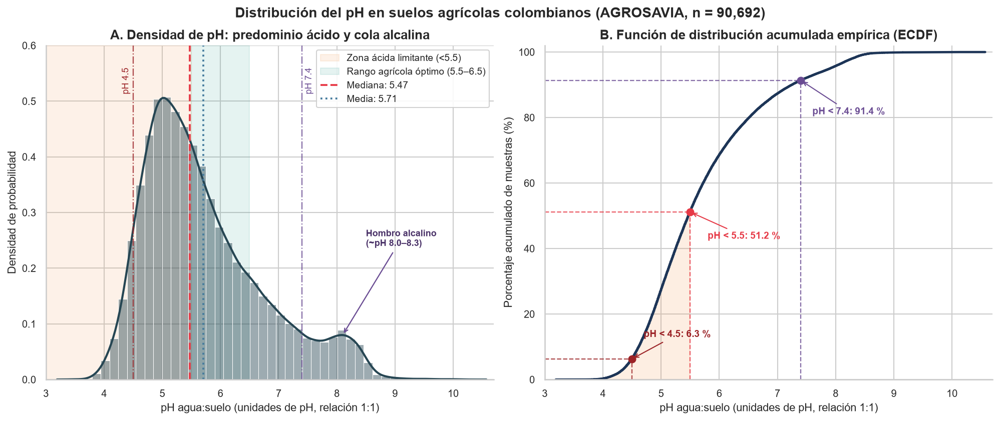
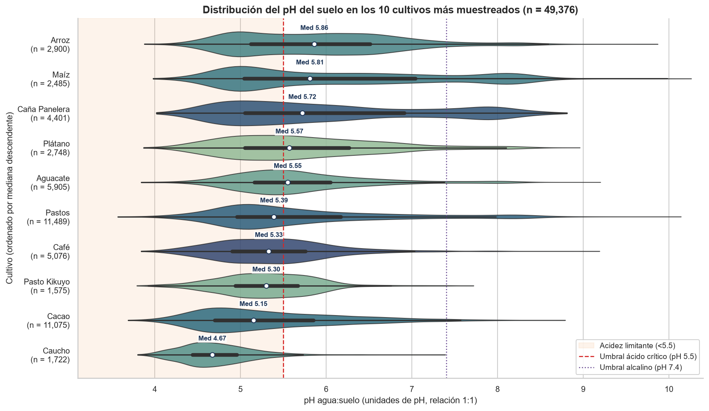
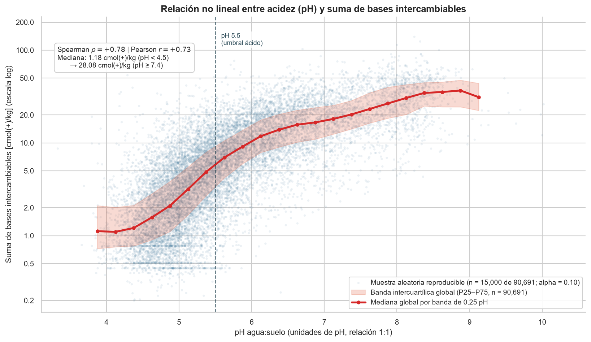
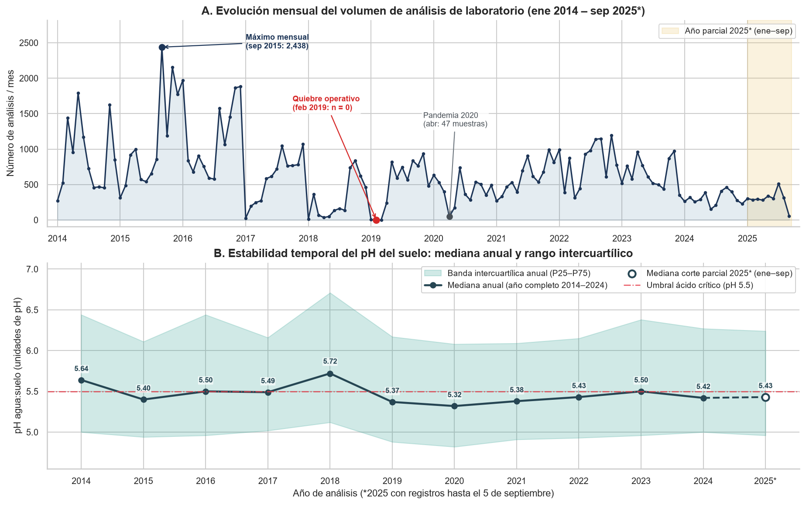
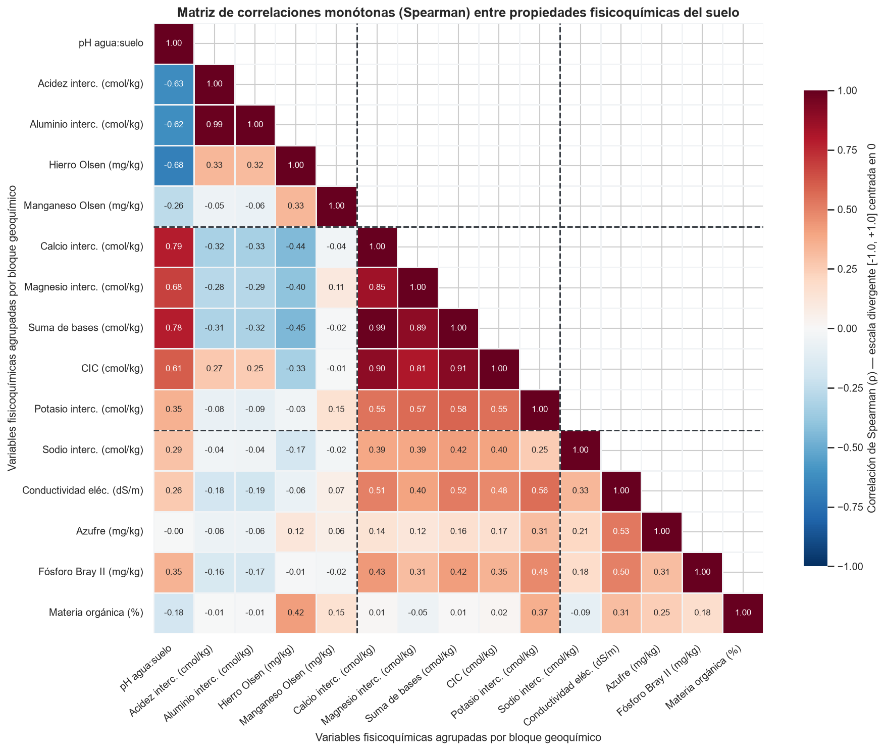

# Análisis Exploratorio de Datos (EDA) — Suelos de Colombia (AGROSAVIA, 2014–2025)

Análisis exploratorio completo, reproducible y trazable sobre la fertilidad y química fisicoquímica de los suelos agrícolas de Colombia a partir de registros oficiales de laboratorio de **AGROSAVIA**, desarrollado con **`pandas`**, **`numpy`**, **`matplotlib`** y **`seaborn`** en Python.

---

## 1. Conjunto de datos y fuente oficial

* **Entidad productora:** Corporación Colombiana de Investigación Agropecuaria (**AGROSAVIA**).
* **Portal oficial:** Datos Abiertos Colombia (`datos.gov.co`) — [Resultados de Análisis de Laboratorio Suelos en Colombia](https://www.datos.gov.co/Agricultura-y-Desarrollo-Rural/Resultados-de-An-lisis-de-Laboratorio-Suelos-en-Co/ch4u-f3i5/about_data).
* **Licencia declarada:** `Creative Commons Attribution | Share Alike 4.0 International` (**CC BY-SA 4.0**).
* **Cobertura temporal y geográfica:** Análisis registrados entre el **7 de enero de 2014 y el 5 de septiembre de 2025**, abarcando los **32 departamentos de Colombia y Bogotá, D.C.** (`33` entidades territoriales y `982` municipios estandarizados).
* **Contenido analítico:** Combina fecha de análisis, ubicación (`departamento`, `municipio`), información agronómica (`cultivo`, `estado_cultivo`, `tiempo_establecimiento`, `topografia`, `drenaje`, `riego`, `fertilizantes_aplicados`) y **21 determinaciones fisicoquímicas** (pH agua:suelo, materia orgánica, fósforo Bray II, azufre, acidez y aluminio intercambiables, bases intercambiables Ca/Mg/K/Na, CIC, conductividad eléctrica, boro y micronutrientes Fe/Cu/Mn/Zn por Olsen y doble ácido).

### Dimensiones antes y después de la limpieza (`pandas`)

| Versión del conjunto | Archivo | Dimensiones | Cambios principales documentados |
| :--- | :--- | :--- | :--- |
| **Crudo** | `data_raw/Resultados_de_Análisis_de_Laboratorio_Suelos_en_Colombia_20261123.csv` | **92,738 filas × 32 columnas** | 32 columnas leídas como texto; `652,157` faltantes ocultos (`'ND'` y `'No indica'`); `2,046` filas duplicadas tras `Secuencial`; espacio oculto `\xa0` en un encabezado; coma `,` con doble rol (miles vs. decimal) y censura analítica (`<LD`, `>UL`). |
| **Depurado** | `data_processed/suelos_limpios.csv` | **90,692 filas × 38 columnas** | Encabezados normalizados a `snake_case` con unidades; eliminación de `2,046` duplicados (`2014–2019`); tipado nativo (`datetime64`, `Int64`, `float64`); estandarización categórica respetando la homonimia `CHIMA` (Santander) vs. `CHIMÁ` (Córdoba); imputación `LD/2` solo en escalas de razón; y **6 variables derivadas** (`anio_analisis`, `mes_analisis`, `clase_ph`, `suma_bases_cmol_kg`, `metodo_micronutrientes`, `n_analitos_censurados`). |

---

## 2. Estructura del repositorio

```text
.
├── data_raw/
│   └── Resultados_de_Análisis_de_Laboratorio_Suelos_en_Colombia_20261123.csv
├── data_processed/
│   └── suelos_limpios.csv
├── figures/
│   ├── fig1_distribucion_ph.png
│   ├── fig2_ph_por_cultivo.png
│   ├── fig3_ph_vs_suma_bases.png
│   ├── fig4_evolucion_temporal.png
│   ├── fig5_heatmap_correlaciones.png
│   └── fig_bitacora_sobreploteo.png
├── eda_suelos_agrosavia.ipynb
├── requirements.txt
├── .gitignore
└── README.md
```

---

## 3. Preguntas de investigación y resumen de hallazgos

1. **Control geoquímico del pH:** *¿En qué medida el pH del suelo regula la aparición de toxicidad por aluminio intercambiable, la retención de bases intercambiables y la disponibilidad de hierro y fósforo en los suelos agrícolas colombianos?*
   * **51.16 %** (`46,395` de `90,692`) presenta acidez limitante (`pH < 5.5`) y **6.31 %** (`5,725`) acidez extrema (`< 4.5`), situando la mediana nacional (**5.47**, `RIC = 1.31`) fuera del rango agrícola óptimo (`5.5–6.5`, apenas **28.73 %**), mientras solo **8.65 %** es alcalino (`pH >= 7.4`).
   * Bajo `pH 5.5` ocurre un umbral abrupto de toxicidad alumínica (`Acidez–Al` $\rho = +0.988$): la mediana de aluminio salta de `0.00 cmol(+)/kg` (`pH >= 5.5`) a `2.70 cmol(+)/kg` (`pH < 4.5`, donde **68.61 %** supera `Al > 2 cmol(+)/kg`).
   * La mediana de `suma_bases_cmol_kg` se multiplica **23.8×** entre `pH < 4.5` (`1.18 cmol(+)/kg`) y `pH >= 7.4` (`28.08 cmol(+)/kg`, $\rho = +0.782$). En sentido inverso, `hierro Olsen` cae **31.3×** (`410.22` a `13.11 mg/kg`, $\rho = -0.682`), `fósforo Bray II` sube **6.9×** (`4.17` a `28.65 mg/kg`, $\rho = +0.350`) y el **84.13 %** de las extracciones por `Doble ácido` se concentra en `pH < 5.5` ($V$ de Cramér $= 0.1144$).

2. **Diferenciación entre cultivos y regiones:** *¿Cómo se diferencian la acidez y la materia orgánica entre los principales cultivos y departamentos de Colombia, y pesa más el contexto edafoclimático regional que la especie cultivada?*
   * Entre los 10 cultivos más muestreados ($N = 49,376$), la mediana de pH varía en **1.19 unidades**, desde `Arroz` (`5.86`), `Maíz` (`5.81`) y `Caña Panelera` (`5.72`) hasta `Cacao` (`5.15`) y `Caucho` (`4.67`, con **95.70 %** bajo `pH 5.5`; Kruskal-Wallis $H = 4,760.8$, $\varepsilon^2 = 0.0963$). La materia orgánica separa aún más a los cultivos ($H = 10,892.2$, $\varepsilon^2 = 0.2205$): sistemas altoandinos como `Pasto Kikuyo` (`9.93 %`) y `Aguacate` (`5.14 %`) multiplican los valores de cultivos cálidos de tierras bajas (`Arroz 1.84 %`, `Maíz 1.85 %`).
   * No obstante, **la geografía pesa entre 2.3× y 3.3× más que el cultivo sobre la acidez**: los 10 departamentos principales explican $\varepsilon^2 = 0.2241$ ($H = 14,532.8$) y las 33 entidades territoriales alcanzan **$\varepsilon^2 = 0.3144$** ($H = 28,538.3$), con un gradiente de **3.44 unidades de pH mediano** desde `Amazonas` (`4.64`) y `Guaviare` (`4.66`) hasta `Valle del Cauca` (`6.16`) y `La Guajira` (`8.08`). La bimodalidad de `Maíz` y `Caña Panelera` y el salto aparente de `topografia = "Plano y pendiente"` (`pH 7.58`, `68.18 %` procedente del Caribe seco) se explican por confusión geográfica.

3. **Dinámica temporal del muestreo, protocolos y estabilidad química (2014–2025):** *¿Cómo evolucionaron el volumen mensual de análisis de laboratorio, los protocolos analíticos y la acidez edáfica nacional entre enero de 2014 y septiembre de 2025?*
   * El trienio **2014–2016** concentró el **41.65 %** del histórico (`37,773` análisis; máximo de `2,438` en septiembre de 2015), seguido de una paralización en el primer trimestre de **2019** (`febrero = 0`), una caída en **abril de 2020** (`47` análisis durante la pandemia), una recuperación en **2022** (`9,784`) y el corte parcial **2025\*** (`2,685` hasta el 5 de septiembre).
   * Pese a esas fluctuaciones de demanda, la mediana anual de pH permaneció estable entre **5.32** (`2020`) y **5.72** (`2018`) ($\varepsilon^2 = 0.0081$, `38.8×` menor que el efecto departamental); las variaciones leves responden a cambios en la composición territorial de los envíos (participación del Caribe de `27.79 %` en `2018` frente a `15.55 %` en `2020`). Operativamente se documentan el descenso de `Doble ácido` (`12.53 %` en `2014` a `0.58 %` en `2021`), el tope instrumental `CE == 12.88 dS/m` exclusivo de `2019–2025` (`86` registros) y `0` duplicados desde `2020`.

---

## 4. Figuras principales

### Figura 1 — Distribución univariada del pH agua:suelo


Más de la mitad de las muestras (`51.2 %`) presenta acidez limitante (`pH < 5.5`) y `6.3 %` acidez extrema (`< 4.5`), situando la mediana (`5.47`) bajo la media (`5.71`) y fuera del rango agrícola óptimo (`5.5–6.5`, apenas `28.7 %`). La distribución exhibe asimetría derecha (`g1 = +0.92`) y un hombro alcalino secundario alrededor de `pH 8.0–8.3` (`8.6 %` con `pH >= 7.4`).

### Figura 2 — Comparación de pH entre los 10 cultivos más frecuentes


El pH mediano cae `1.19` unidades desde `Arroz` (`5.86`) y `Maíz` (`5.81`) hasta `Cacao` (`5.15`) y `Caucho` (`4.67`, concentrado bajo `5.5` con `RIC = 0.52`). `Maíz` (`RIC = 2.00`) y `Caña Panelera` (`RIC = 1.86`) exhiben distribuciones bimodales con un segundo lóbulo en `pH 7.5–8.3`, reflejando su presencia tanto en suelos ácidos como alcalinos.

### Figura 3 — Relación no lineal entre pH y suma de bases intercambiables


La suma de bases crece fuertemente con el pH ($\rho = +0.78$) siguiendo una curva sigmoidal en escala logarítmica: la mediana global pasa de `1.18 cmol(+)/kg` (`pH < 4.5`) a `3.85` (`5.0–5.5`) y alcanza `28.08 cmol(+)/kg` (`pH >= 7.4`). Por encima de `pH 7.8` la tendencia se estabiliza en una meseta (`~31–36 cmol(+)/kg`) manteniendo amplia dispersión vertical.

### Figura 4 — Evolución temporal mensual del volumen de análisis y anual del pH


La demanda analítica mensual fue máxima en `2014–2016` (pico de `2,438` muestras en septiembre de `2015`), cayó a cero en febrero de `2019`, descendió a `47` en abril de `2020` y repuntó en `2022`. Pese a esa volatilidad operativa, la acidez nacional se mantuvo estable con medianas anuales entre `5.32` (`2020`) y `5.72` (`2018`) y `P25` entre `4.8` y `5.1`.

### Figura 5 — Matriz de correlaciones de Spearman entre variables fisicoquímicas


Emergen dos bloques geoquímicos de signo opuesto en torno al pH: `Acidez` y `Aluminio` correlacionan casi en identidad ($\rho = +0.99$) y negativamente con el pH (`-0.62` a `-0.63`), junto con `Hierro Olsen` (`-0.68`). En contraste, `Calcio`, `Magnesio`, `Suma de bases` y `CIC` forman un bloque positivo compacto (`+0.81` a `+0.99`), mientras `Conductividad eléctrica` se enlaza con `Azufre` (`+0.53`), `Suma de bases` (`+0.52`) y `Fósforo` (`+0.50`).

> **Nota de bitácora visual:** La carpeta `figures/` incluye además la figura diagnóstica [`figures/fig_bitacora_sobreploteo.png`](figures/fig_bitacora_sobreploteo.png), que compara el gráfico lineal crudo con sobreploteo extremo frente a la solución final en escala logarítmica de la Figura 3.

---

## 5. Cómo reproducir el análisis desde cero

### Requisitos previos
* **Python 3.11 o superior** (el análisis original fue ejecutado y verificado en **Python 3.14.7**).
* **Git** para clonar el repositorio.

### Paso 1 — Clonar el repositorio

```bash
git clone https://github.com/diperezmo/Parcial.-An-lisis-exploratorio-de-datos-con-Python.git
cd Parcial.-An-lisis-exploratorio-de-datos-con-Python
```

### Paso 2 — Crear y activar el entorno virtual `.venv`

**En Windows (PowerShell):**

```powershell
python -m venv .venv
.\.venv\Scripts\Activate.ps1
```

**En Linux / macOS:**

```bash
python3 -m venv .venv
source .venv/bin/activate
```

### Paso 3 — Instalar las dependencias exactas

Con `pip` estándar dentro del entorno virtual activado:

```bash
python -m pip install --upgrade pip
python -m pip install -r requirements.txt
```

*(Alternativa si trabajas con [`uv`](https://docs.astral.sh/uv/)):*

```bash
uv venv .venv
uv pip install -r requirements.txt
```

### Paso 4 — Ejecutar `eda_suelos_agrosavia.ipynb`

* **Opción A (Interactiva en VS Code o Jupyter):**
  1. Abre `eda_suelos_agrosavia.ipynb`.
  2. Selecciona el kernel de Python correspondiente al entorno `.venv`.
  3. Ejecuta **Restart & Run All** (Reiniciar y ejecutar todas las celdas).

* **Opción B (Automatizada desde terminal con `nbformat` y `nbclient`):**
  ```bash
  python -c "import nbformat, nbclient; nb = nbformat.read('eda_suelos_agrosavia.ipynb', as_version=4); nb = nbclient.execute(nb, cwd='.', timeout=600, kernel_name='python3'); nbformat.write(nb, 'eda_suelos_agrosavia.ipynb')"
  ```
  Al finalizar sin errores, el flujo regenera `data_processed/suelos_limpios.csv` (`90,692 × 38`) y las seis imágenes en `figures/`.

---

## 6. Limitaciones, bitácora técnica y transparencia

* **Limitaciones principales:** Los datos proceden de un servicio analítico por demanda y no de un muestreo probabilístico territorial: cinco departamentos (`Cundinamarca`, `Valle del Cauca`, `Meta`, `Antioquia` y `Nariño`) concentran el **49.59 %** de las muestras frente al **0.26 %** en los cinco menos muestreados (`Vaupés`, `San Andrés y Providencia`, `Guainía`, `Amazonas` y `Chocó`). El reemplazo transparente de `'ND'` y `'No indica'` eleva los faltantes reales al **18.53 %** (solo **19.90 %** de filas tiene los 7 metadatos de campo completos) y la convención `LD/2` afecta al **69.86 %** de los registros. Por su diseño observacional transversal sin coordenadas ni profundidad de muestreo, ninguna asociación implica causalidad directa.
* **Bitácora y uso de IA:** En el cuaderno (`Secciones 4.2, 10 y 13`) se documentan **12 incidencias técnicas reales** con evidencia empírica y solución aplicada, y en la `Sección 14` se declara de forma transparente el uso de un asistente de IA (Google Antigravity / Gemini) como apoyo de consulta y aprendizaje (tutoría conceptual y técnica), además de asistencia en escritura/depuración de código, organización del cuaderno y redacción.
